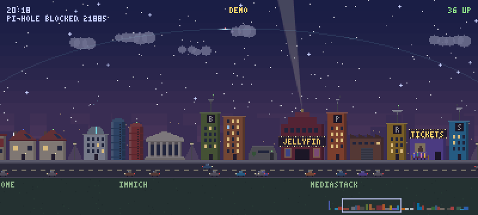

# homelab world

Your Docker containers as a living pixel city. Every compose project is a district and every container is a building.



- **Buildings** depend on what the container is (see [Buildings](#buildings)): Jellyfin is a cinema, Home Assistant a house with solar panels, Grafana an observatory, Vaultwarden a bank, Forgejo a factory that smokes with its CPU, Homepage a town hall with a working clock. Anything it can't place becomes an apartment tower, and a label lets you choose.
- **Windows** light up with CPU load and flicker more when a container is busy.
- **Cars** leave a building for outgoing traffic and arrive for incoming traffic.
- **Jellyfin** sweeps a searchlight across the sky while someone is streaming.
- **Health**: stopped containers go dark, unhealthy ones smoke with a red beacon, and starting ones get scaffolding. The watchtower turns red when anything is wrong.
- **Events** like start, stop, OOM and health changes trigger confetti, smoke and a ticker line.
- **Pi-hole** (optional): every blocked query is a drop of rain bouncing off a shield over the city.
- **Time of day** follows real time, with sky, sun, moon, stars and street lights.
- **Big stacks**: when the city is wider than the screen, the camera drifts slowly along the street and flies to a building when something happens to it. A minimap in the corner shows the whole city, with stopped and unhealthy containers in red.

## Try it first

Demo mode makes up a homelab of 36 containers in the browser, with streams, restarts, crashes and Pi-hole rain, so it needs no access to your Docker at all:

```sh
docker run --rm -p 8099:8099 ghcr.io/stijnie2210/homelab-world
open "http://localhost:8099/?demo"
```

Use `?demo=120` to see a bigger stack. Without Docker, open `web/index.html?demo` straight from a checkout.

## Run

Download [`compose.yaml`](compose.yaml) (and [`.env.example`](.env.example) if you want Pi-hole rain), then:

```sh
cp .env.example .env   # optional, for Pi-hole rain
docker compose up -d
open http://localhost:8099
```

The image is built for amd64 and arm64 (a Raspberry Pi works), about 10 MB, and runs as an unprivileged user. The backend is one stdlib-only Go binary with the frontend embedded.

On Linux, first put the id of the `docker` group in `.env` (see [Docker access](#docker-access)):

```sh
echo "DOCKER_GID=$(getent group docker | cut -d: -f3)" >> .env
```

## Docker access

homelab world never gets the Docker socket itself. The compose file puts [wollomatic/socket-proxy](https://github.com/wollomatic/socket-proxy) in between, on an internal network that only the two of them share, and the proxy allows four read-only requests and refuses everything else:

| Request | Used for |
|---|---|
| `GET /_ping` | finding the API version |
| `GET /containers/json` | the list of containers, with their state, health and labels |
| `GET /containers/{id}/stats` | CPU, memory and network per container |
| `GET /events` | starts, stops, crashes and health changes as they happen |

That matters because mounting the socket with `:ro` does not make the Docker API read-only: anything that can talk to the socket can start containers, read their files and environment, and so take over the host. Through the proxy, homelab world can't even inspect a container, so environment variables and secrets never pass through it.

The proxy runs as an unprivileged user in the group that owns the socket. That's group `0` on OrbStack (the default) and the `docker` group on Linux, which is why Linux needs `DOCKER_GID` in `.env`. On Docker Desktop, check with `docker run --rm -v /var/run/docker.sock:/s alpine stat -c %g /s`. If the proxy can't reach the socket or refuses a request, the page says so in a red banner, and `docker logs homelab-world-socket-proxy` shows the refused paths.

Already running a socket proxy? Point `DOCKER_HOST` at it and allow the four requests above. With `tecnativa/docker-socket-proxy` that's `CONTAINERS=1` (`EVENTS` and `PING` are on by default), although that also opens container logs and file downloads. To skip the proxy, mount the socket, set `DOCKER_HOST=unix:///var/run/docker.sock`, and run the container in the socket's group with `user: "65534:${DOCKER_GID:-0}"` (the image runs as an unprivileged user).

| Variable | Default | |
|---|---|---|
| `DOCKER_HOST` | `unix:///var/run/docker.sock` (`tcp://socket-proxy:2375` in the compose file) | `unix://` or `tcp://` |
| `DOCKER_GID` | `0` | group that owns the Docker socket, for the proxy |
| `PIHOLE_URL`, `PIHOLE_PASSWORD` | | optional, Pi-hole v6 rain |
| `POLL_INTERVAL` | `2s` | how often stats are read |
| `ADDR` | `:8099` | listen address |

## Buildings

The building is picked from the container's name and image. The first match in this list wins, so a database belonging to an app (`immich_postgres`, `paperless-db`) becomes a silo, not part of the app.

| Kind | Building | Recognises, for example |
|---|---|---|
| `lab` | lab with a glowing antenna | machine learning, Ollama, Open WebUI, Whisper |
| `silo` | silo | Postgres, MariaDB, MySQL, Redis, Valkey, InfluxDB, Elasticsearch, names ending in `-db` |
| `bunker` | bunker | socket proxies, Gluetun, WireGuard, Tailscale, Cloudflared, CrowdSec |
| `crane` | construction crane | Portainer, Watchtower, Diun, Komodo, Dockge |
| `studio` | broadcast studio in the app's colour, with its letter on the front and a dish that turns with the traffic | Sonarr, Radarr, Lidarr, Readarr, Prowlarr, Bazarr, Jackett, Autobrr |
| `boxoffice` | box office with a marquee, a queue forms with the traffic | Seerr, Overseerr, Jellyseerr, Ombi |
| `cinema` | cinema, searchlight while streaming | Jellyfin, Plex, Emby, Navidrome |
| `lighthouse` | lighthouse | Pi-hole, AdGuard Home, Blocky |
| `antenna` | radio mast | Unbound, dnsmasq, CoreDNS |
| `gallery` | museum | Immich, PhotoPrism, Lychee |
| `watchtower` | watchtower, red when anything is wrong | Uptime Kuma, Gatus, Healthchecks, Frigate |
| `observatory` | observatory | Grafana, Prometheus, Netdata, Loki, Dozzle, Beszel |
| `house` | house with a smart light | Home Assistant, Zigbee2MQTT, ESPHome, Node-RED |
| `postoffice` | post office, envelopes fly with the traffic | Mosquitto, RabbitMQ, NATS, ntfy, Gotify, mail servers |
| `bank` | bank, the vault door turns while it works | Vaultwarden, Authentik, Authelia, Keycloak, Actual, Firefly III |
| `office` | glass office tower | Nextcloud, Seafile, OnlyOffice, Filebrowser |
| `library` | library with books in the window | Paperless, Calibre, Kavita, Audiobookshelf, BookStack, wikis, Linkding, FreshRSS |
| `factory` | factory, smokes with its CPU | Forgejo, Gitea, GitLab, CI runners, n8n, Tdarr, Stirling PDF |
| `townhall` | town hall with a clock and an "N UP" sign | Homepage, Homarr, Heimdall, Dashy, Glance |
| `shop` | corner shop | Mealie, Grocy, IT-Tools, CyberChef, PrivateBin |
| `warehouse` | warehouse | qBittorrent, SABnzbd, Syncthing, MinIO, backup tools |
| `gate` | city gate | Traefik, Caddy, nginx, Nginx Proxy Manager |
| `tower` | apartment tower | everything else |

### Labels

| Label | Effect |
|---|---|
| `homelab-world.kind=observatory` | use this building, whatever the name or image says |
| `homelab-world.hide=true` | leave the container out of the city and the ticker (init containers, sidecars) |

```yaml
services:
  weather:
    image: example/weather-station
    labels:
      homelab-world.kind: observatory
```

## Controls

| | |
|---|---|
| `N` | cycle day / dusk / night / dawn / live |
| `D` | fire a random demo event, plus some rain |
| double-click | fullscreen (good for a wall tablet) |
| drag, scroll, `←` `→` | pan a city that's wider than the screen; the camera leaves you alone for 30 seconds |
| `?hour=21` | freeze the time of day |
| `?speed=600` | fast-forward the day |
| `?scale=4` | force pixel size |
| `?fit` | shrink the pixels until the whole city fits, instead of panning |
| `?demo`, `?demo=120` | made-up homelab, no Docker needed |

## Hacking on it

```sh
docker compose -f compose.yaml -f compose.dev.yaml up -d --build   # serves web/ from disk
dev/fixtures.sh up                                                 # a fake homelab of ~37 busybox containers
dev/fixtures.sh down                                               # remove them again
```

With `compose.dev.yaml`, a browser refresh is enough to see frontend changes; Go changes need the `--build`. The fixtures are named after common apps, a few have (failing) health checks or CPU bursts, and two show the labels. Building kinds live in `KINDS` in `web/world.js`, the matching rules in `KIND_RULES`.

## Releasing

Every push to `main` publishes `ghcr.io/stijnie2210/homelab-world:main` and `:sha-<commit>`. A tag like `v0.1.0` publishes `:0.1.0`, `:0.1` and `:latest`, which is what `compose.yaml` pulls:

```sh
git tag v0.1.0 && git push origin v0.1.0
```

## License

[MIT](LICENSE)
